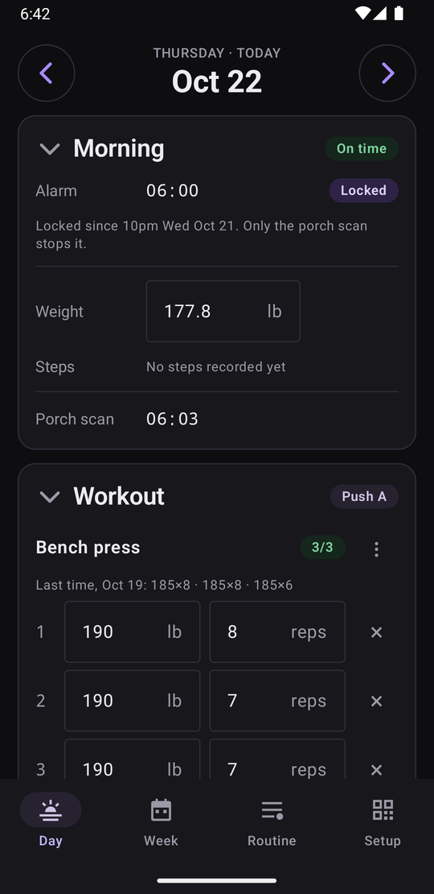
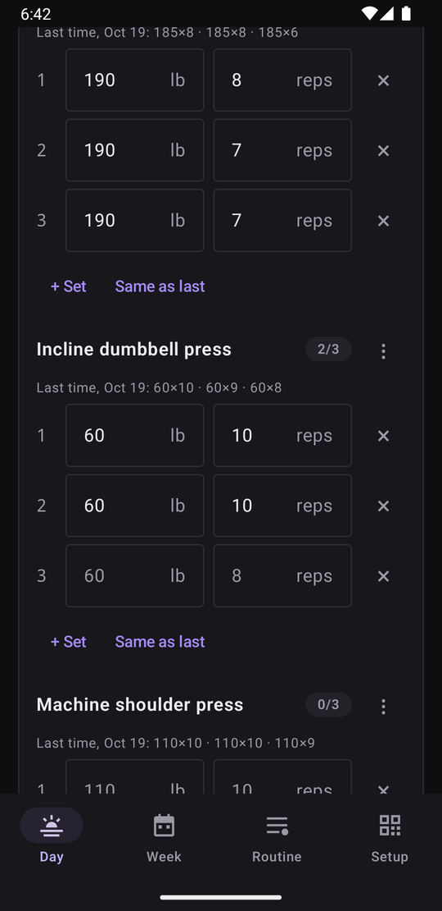
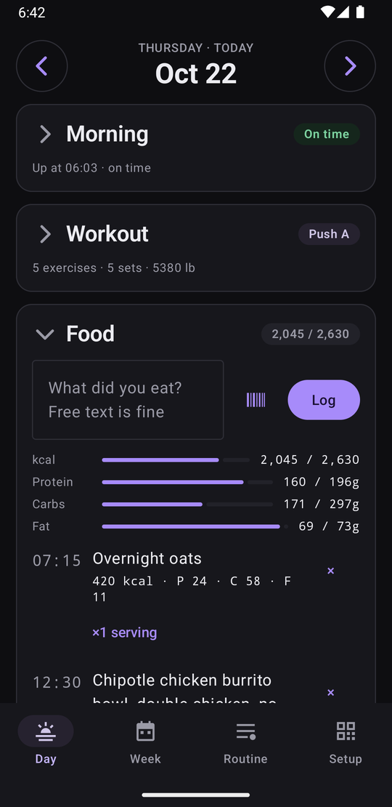
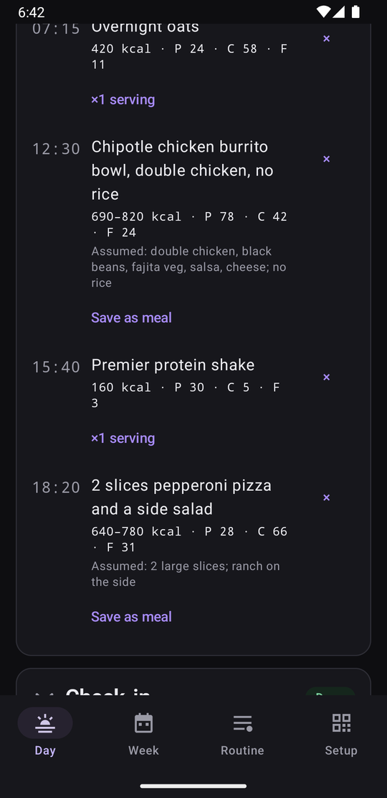
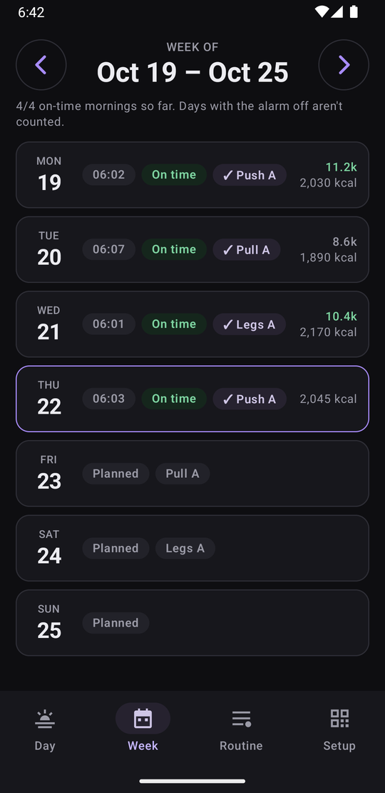
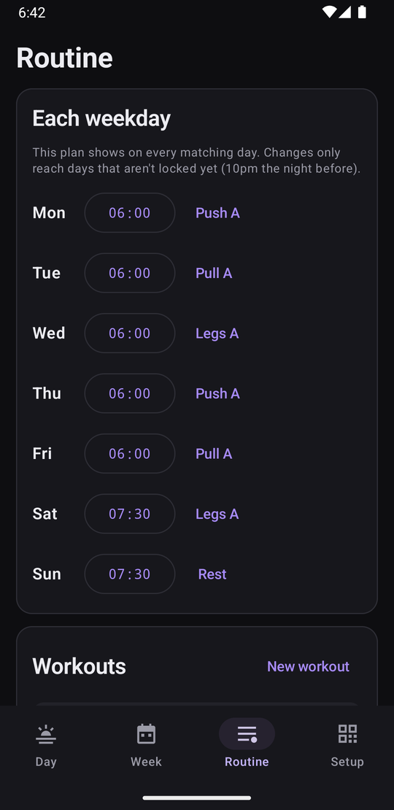
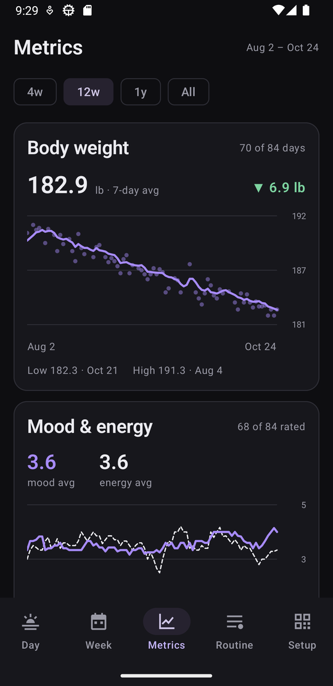
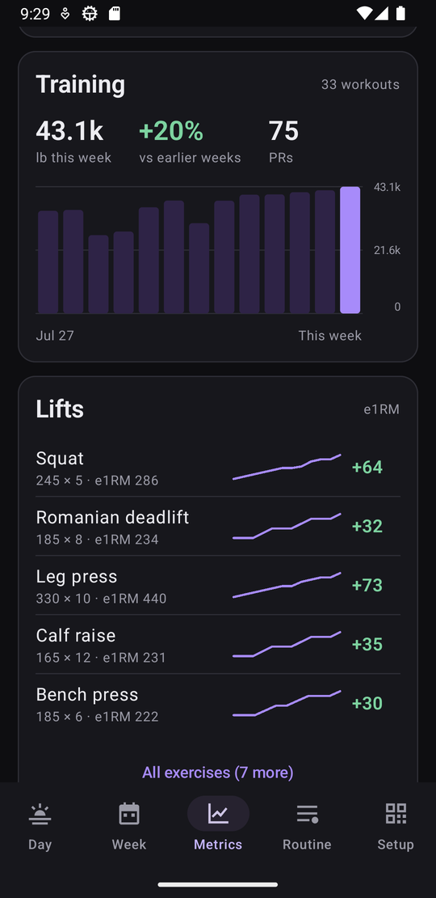
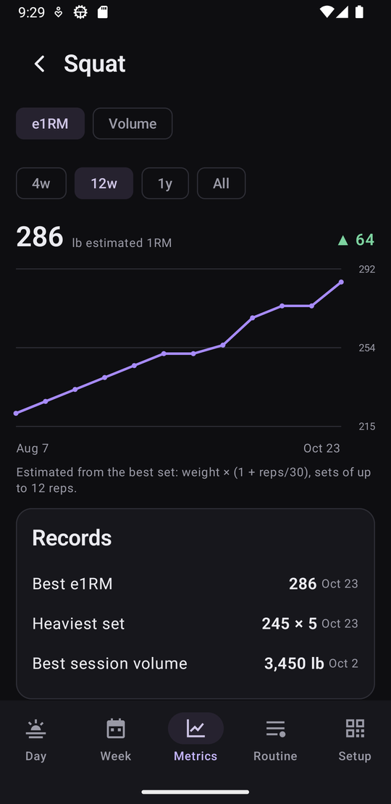

# Diurna

> An Android app for getting up on time, getting outside and keeping an honest record of each day. Open source under [MIT](LICENSE); the work list is [BACKLOG.md](BACKLOG.md).

*Diurna* is Latin for "daily things": Rome's *Acta Diurna* were public notices of each day's events. The app was called Daybook at first. The code package is now `app.diurna`, but the app id stays `app.daybook` (changing it would make Android treat it as a different app, with none of the old one's data), as do the database and backup file names.

## Mission

**Get up at the same time every morning, get outside, and keep an honest record of each day.**

Diurna treats a *day* as the basic unit: each day has a morning, the food eaten, maybe a workout, a step count and an evening check-in. The alarm stops only when you scan a QR code on the porch, so being up and being outside become one action that can't be faked from bed. Everything else is a fast log that builds into a history worth looking back on.

### Principles

- **The day is the record.** Days roll over at midnight. The weekly routine is a template laid over each day; once you start logging a day, it owns its data, and editing the routine never rewrites the past.
- **Hard to cheat, easy to plan.** You can change or turn off an alarm until 10pm the night before; after that it's locked. There's no snooze and no emergency exit. Turning the alarm off ahead of time is fine, and those days don't count against you.
- **Honest data.** Manual mornings are marked as manual. Backfilled food is tagged. A day with the alarm off is excluded from scoring instead of counting as missed.
- **Low-friction logging.** Food is free text, a saved meal or a barcode scan. Sets are pre-filled from last time, and the keyboard's Next key walks through them.
- **Local and private.** No account and no server of its own; everything lives on the phone. It makes exactly two kinds of network call: food you log goes to the AI provider you pick (Claude or Grok) with *your own* API key, and barcode numbers you scan go to [Open Food Facts](https://world.openfoodfacts.org).

## Screenshots

Demo data on an emulator (`scripts/demo-data` fills one); none of it is real.

<table>
  <tr>
    <td align="center"><br><sub><b>Morning:</b> on time, locked alarm, porch scan</sub></td>
    <td align="center"><br><sub><b>Workout:</b> last time's sets as hints</sub></td>
    <td align="center"><br><sub><b>Food:</b> intake against targets</sub></td>
  </tr>
  <tr>
    <td align="center"><br><sub><b>Estimates:</b> AI ranges with assumptions, exact saved meals</sub></td>
    <td align="center"><br><sub><b>Week:</b> mornings, workouts, steps, calories</sub></td>
    <td align="center"><br><sub><b>Routine:</b> the weekly template</sub></td>
  </tr>
  <tr>
    <td align="center"><br><sub><b>Metrics:</b> weight trend, mood and energy</sub></td>
    <td align="center"><br><sub><b>Training:</b> weekly volume, lifts by e1RM</sub></td>
    <td align="center"><br><sub><b>Lift:</b> e1RM per session, records</sub></td>
  </tr>
</table>

## How it works

| Area | Where |
|---|---|
| Alarm rules (lock time, which alarm applies, next alarm, scoring) | `domain/AlarmRules.kt`, plain Kotlin with unit tests |
| Storage (Room/SQLite; dates `yyyy-MM-dd`, times `HH:mm`, both local) | `data/Entities.kt`, `data/Daos.kt`, `data/*Repository.kt` |
| Settings (porch code secret, profile, step goal, lock-screen toggle, position and text size; DataStore) | `data/SettingsStore.kt` |
| Alarm: one exact `setAlarmClock` alarm, a foreground service that rings the phone's default alarm sound, a full-screen scan screen | `alarm/` |
| Porch QR: generate (ZXing) and scan (CameraX + ML Kit, offline) | `scan/Qr.kt` |
| Lock-screen summary: drawn as a lock-only wallpaper, centred and split around the fingerprint sensor (the day's lines just above it, the week's dots below), lines wrapping, position and text size adjustable in Setup with a live preview, redrawn when its content or settings change, at 10pm and at midnight | `wallpaper/`, `ui/SetupLockScreen.kt` |
| Targets: Mifflin–St Jeor × activity + goal, macros from body weight and fat % | `domain/Targets.kt` |
| Food estimates: one AI call per entry (structured JSON) when logged or its text changes, to the provider picked in Setup: Claude (`claude-haiku-5-5`, the default), Grok (`grok-4.20-non-reasoning` via xAI's chat completions), or an OpenAI-compatible gateway (user base URL + model + optional key); optional Anthropic/xAI endpoint overrides; retried in the background by WorkManager, capped at 8 tries; every API error mapped to a plain message (`ai/EstimateErrors.kt`); keys encrypted with the Android Keystore | `ai/` |
| Meal photos: optional photo on a food entry from the camera (`TakePicture` into a FileProvider scratch file) or the system photo picker, so no storage permission; decoded straight to at most 1568 px, saved as JPEG under 3.5 MB in `files/food-photos`, sent with the text as a base64 image (Claude image block, xAI `image_url` data URI). Kept out of cloud backup (its 25 MB cap), mirrored into self-backups; unused files swept at startup | `data/FoodPhotos.kt`, `data/PhotoImporter.kt`, `domain/PhotoSizing.kt`, `ui/FoodPhotoUi.kt` |
| Barcode scanning: EAN/UPC codes looked up on Open Food Facts and checked in the meal form before saving; rescans come from the library and work offline. Answers are treated as untrusted: HTTPS only, no redirects, size and time caps, sanity limits on numbers, plain short text | `data/BarcodeLookup.kt`, `ui/BarcodeScanDialog.kt` |
| Library: saved meals (exact numbers, tap to log, servings, optional barcode) and the exercise catalog (seeded with common lifts and a typical Planet Fitness lineup; rename, hide, delete if unused), under Setup | `data/LibraryRepository.kt`, `data/ExerciseSeed.kt`, `ui/LibraryScreens.kt` |
| Cardio (optional; Setup → Library → "Cardio exercises"): exercises of kind `cardio` are logged as pieces instead of weight × reps, every field optional (distance, time, avg pace, best split, avg W, Cal, avg HR). Each has a style (`Cardio.Style`: rowing /500m, run or walk /km or /mi, cycling km/h or mph, time and calories) that picks the fields and units; pace is stored as seconds per 500 m and converted for display. "Log from photo" sends a machine or app summary screen to the selected AI provider (strict JSON with units, 0 = not shown, values capped) and shows the numbers to check before saving. With the setting off, cardio stays out of suggestions and Library; kept out of lifting volume and e1RM | `domain/Cardio.kt`, `ai/CardioReader.kt`, `ui/CardioUi.kt` |
| Workout logging: Enter walks weight → reps → next set; an empty field's grey hint (the set above, else last time) is accepted with Enter; exercises can be moved or removed; tapping an exercise name folds it to one line, and finished exercises turn green | `ui/DayScreen.kt`, `domain/SetHints.kt` |
| Steps: counted from the phone's hardware step sensor (running total since boot), checked every 15 minutes, at 23:59 and at boot; the rules for reboots and midnight are in `domain/StepMath.kt`; shown against a goal and frozen per day | `steps/`, `data/StepCounter.kt` |
| Evening check-in: mood and energy (1–5) per day, with a 9pm reminder that skips rated days | `checkin/`, `domain/Ratings.kt` |
| Week view: each day's morning, workout, steps and calories | `ui/WeekScreen.kt` |
| Metrics: weight with a 7-day average, mood and energy, a Macros card once any food is estimated (stacked kcal from protein/carbs/fat, kcal/% toggle, optional target line), weekly training volume and PRs, lifts by estimated 1RM (Epley, sets of up to 12 reps) with a per-exercise screen (also opened from an exercise's ⋮ menu on Day, where back returns to Day); a Cardio card once any cardio is logged: weekly distance (or minutes) and per-exercise distance and pace or speed, power, or time and calories, PRs only against earlier sessions of the same length (rounded minutes, else distance). Worked out from current data on the fly; nothing extra is stored. Charts are drawn with Compose `Canvas` | `domain/Metrics.kt`, `data/MetricsRepository.kt`, `ui/MetricsScreen.kt`, `ui/Charts.kt` |
| Finalizing days: once a day ends, its alarm, planned workout, targets and steps are frozen so later routine or profile edits don't rewrite history | `data/DayFinalizer.kt` |
| Self-backups: a consistent copy of the database and settings daily (keeps 14) in the app's shared-storage folder, readable over `adb`; meal photos mirrored once into `backups/food-photos` | `data/Backups.kt` |
| Export and import: Setup → Backups writes one zip (manifest, a consistent database copy, settings with the porch code, meal photos; never API keys or AI provider settings) wherever the person picks, and imports one on a fresh install. Imports are checked entry by entry (known names only, size caps, `integrity_check`, schema no newer than the app), staged, backed up against, then swapped in at the next start before anything opens the database; older exports migrate as usual | `domain/ExportArchive.kt`, `data/DataTransfer.kt` |
| Shared one-line summaries for the Day screen and lock screen | `domain/DayText.kt` |
| What's new: user-facing notes in `Changelog.kt` (numbered entries, not versions), shown once as a dialog on the first launcher open after an update (not from the check-in notification or the alarm); a fresh install starts caught up. The last seen id lives in settings; Setup lists recent entries | `domain/Changelog.kt`, `ui/WhatsNew.kt` |
| UI: Compose, five tabs (Day, Week, Metrics, Routine, Setup), one ViewModel per screen | `ui/` |

Key data rules:
- A day's alarm is its override if set (a time or `off`), otherwise the routine. Once the day locks, the time that was armed (`day.scheduled_alarm`) is frozen.
- Workouts copy the template's exercises onto the day. Each exercise has `sets[]` of weight and reps; the set count is just the number of rows. A cardio exercise's rows are pieces: the same `exercise_set` table, using the distance/time/split columns instead; an exercise's kind is fixed once it has history.
- Exercise names are one shared catalog, matched without regard to case.
- Food text is the source of truth. Estimates (calorie range, macros, assumptions, model) are derived from it and, when attached, its photo; editing the text or changing the photo re-estimates. A photo needs text with it; where they disagree, the model is told the text wins.
- A saved meal's numbers are copied onto the entry when it's logged (× servings), so editing or deleting the meal never changes past days. Changing a meal entry's text turns it back into an AI entry.
- Every schema change ships with a migration test (`MigrationTest`); never a destructive fallback.

## Building it yourself

Requires JDK 17 and the Android SDK at `~/Android/Sdk` (platform 37), or `sdk.dir` in `local.properties`.

- **Debug builds need no setup:** `./gradlew assembleDebug`, or `scripts/install` with a device connected.
- **Release builds need your own signing key.** Create a keystore in `signing/` (git-ignored) and a `signing/keystore.properties` next to it:
  ```properties
  storeFile=daybook.keystore   # relative to signing/
  storePassword=…
  keyAlias=…
  keyPassword=…
  ```
  Back the keystore up somewhere safe: Android only installs updates signed with the same key, so losing it means uninstalling (and losing the app's data) to install a new build.
- **In the app:** open **Setup**, clear the permission checklist, add a Claude API key for food estimates, or pick Grok and add an xAI key (a separate workspace or team with a spend limit is a good idea), print the porch code and scan it once to arm alarms, then try **Test alarm in 1 minute**.


## Local or LAN model servers

Setup → Food estimates → **OpenAI-compatible** can point at a server you run (Ollama, LM Studio, llama.cpp, LiteLLM, and similar `/v1/chat/completions` hosts).

- **On the phone or emulator:** plain `http` is allowed for `localhost`, `127.0.0.1`, and the emulator’s host alias `10.0.2.2` (traffic to the machine running the emulator).
- **On another machine on your LAN:** use **HTTPS**. Plain `http` to a LAN address is rejected (platform cleartext stays off outside those localhost aliases). Practical options include Tailscale HTTPS certificates via [`tailscale serve`](https://tailscale.com/kb/1242/tailscale-serve), or a reverse proxy such as [Caddy](https://caddyserver.com/) that terminates TLS in front of the model server.

## Scripts

Day-to-day work goes through `scripts/`. Anything that touches a device picks the plugged-in phone first, then a running emulator; set `ANDROID_SERIAL` to choose one yourself.

| Command | What it does |
|---|---|
| `scripts/release` | **Ship to the phone:** tests, release build, backup, install as an update, check no data was lost, check the alarm, tag `release-N` and push the tag. Warns if the app changed but `Changelog.kt` didn't. Needs a clean working tree. |
| `scripts/install` | Build, install and open a **debug** build (`--no-launch` to skip opening) |
| `scripts/test` | Unit tests, plus device tests if an emulator is running (`unit` or `device` for just one) |
| `scripts/emulator` | Start the emulator and wait until it's ready (`--headless` for no window, `--stop` to shut it down) |
| `scripts/logs` | Follow the app's log live (`--crash` for recent crashes) |
| `scripts/screenshot` | Capture the device screen to `~/Downloads` (`--last` copies the newest screenshot taken on the phone) |
| `scripts/demo-data` | **Emulator only:** clear the app's data and fill it with 12 weeks of made-up history (or `scripts/demo-data <weeks>`), for screenshots |
| `scripts/backup-db` | Copy the database off the device into `backups/<timestamp>/`, which git ignores |
| `scripts/alarm-check` | Show the armed alarm and permissions (`--doze` or `--reboot` to stress-test it) |
| `LIVE_API=1 ./gradlew testDebugUnitTest --tests '*LiveApiErrorTest*'` | Check a real API error end to end, using a deliberately invalid key (free) |

**Release builds** are shrunk with R8 (about 25 MB, versus about 80 MB for debug) and not debuggable. `versionCode` is the git commit count, so every release is newer than the last.

**Device tests never run on a real phone.** Gradle uninstalls the app after them, which deletes all of Diurna's data, so `scripts/test` refuses anything but the emulator. Run `./gradlew connectedDebugAndroidTest` by hand only if you know which device it will hit.

**CI:** `.github/workflows/tests.yml` runs the unit tests and the device tests (on an API 33 emulator) for every pull request and every push to `main`. It needs no `signing/` or `local.properties`: debug builds use the standard debug key.

**Wireless debugging** works with the scripts too: pair once in Developer options → Wireless debugging, and `adb` reconnects whenever it's turned on. Keep it on trusted networks only, and off when not in use.

## Backlog

Bugs, features and tech debt are tracked in [BACKLOG.md](BACKLOG.md).
